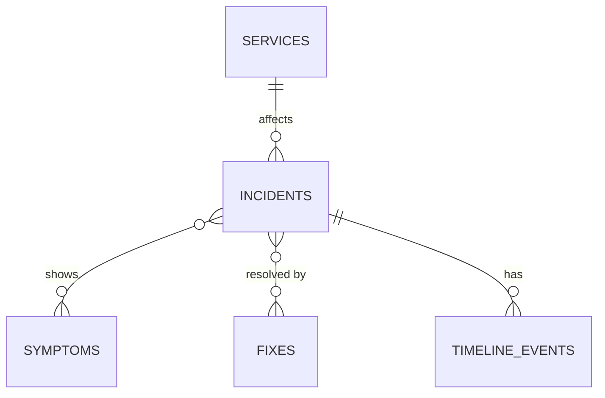

# Incident Memory

> Stop solving the same outage twice. Pick the symptoms you are seeing and get past incidents that match, **with the exact reasons why**, the fix that worked, and how long it took.

Built solo for the **Appwrite Databases Hackathon** (October 2026), on **Appwrite TablesDB**.

- **Live demo:** https://incident-memory.appwrite.network
- **Demo video:** _TODO_
- **Repository:** https://github.com/Aniketshindalkar/Incident-Memory

## The problem

Teams keep re-solving the same outages. Past fixes are buried in chat threads, tickets, and postmortems nobody rereads. Black-box "similar item" suggestions don't help much either, because engineers can't tell *why* something was matched, so they don't trust it.

## What it does

1. **Describe what you see.** Pick the symptoms you are seeing (for example: 502 errors, Redis timeout, started right after a deploy).
2. **Get explained matches.** The app instantly ranks past resolved incidents by how many symptoms they share with yours. Every match is explained: *"Matched because it shares 2 symptoms: 502 errors, Started right after a deploy. Fixed by: Roll back the release. Resolved in 25 min."*
3. **Report the incident.** Log it with a title, severity, and service. Anyone can try it with no sign-up.
4. **Follow it live.** Each incident has a timeline. Updates added in one browser window appear in every other open window instantly.
5. **Close the loop.** Resolving an incident records the fix, the resolve time, and a timeline entry in one atomic step, so the next team benefits.
6. **Search.** Full-text search across incident titles and summaries.

## Architecture: TablesDB, used deliberately

Everything lives in one Appwrite database, **TablesDB**, because the core feature (explainable matching) is about relationships between records. The React app talks to TablesDB directly through the Appwrite SDK, with table permissions controlling access, so there is no custom backend and no API key in the frontend.

| TablesDB feature | How the project uses it |
|---|---|
| **Many-to-many relationships** | Incidents link to symptoms and fixes. Matching counts the symptoms two incidents share, and the app shows which ones. |
| **Many-to-one / one-to-many relationships** | Incidents belong to a service; timeline events belong to an incident. One query loads an incident with its service, symptoms, fixes, and timeline. |
| **Fulltext indexes + `Query.search`** | Word search over incident titles and summaries. |
| **Composite and ordered indexes** | Fast filtering by status and severity, and "newest first" ordering by start time. |
| **Transactions** | "Resolve incident" updates the incident (status, resolve time, linked fix) and adds a timeline entry in a single atomic commit. Either both happen or neither does. |
| **Realtime** | The app subscribes to changes on the incidents and timeline tables, so every open window stays in sync without refreshing. |
| **Permissions** | Anyone can read. Visitors get a silent anonymous session so they can add updates and report incidents. Nobody can delete. |

### How matching works

For the symptoms you pick, the app compares them with each resolved incident's symptoms and scores the overlap (shared symptoms divided by all distinct symptoms in either set). The top three matches are shown together with the shared symptoms, the fixes that resolved them, the service, and the time to resolve. Because the logic is based on explicit relationships, every result can explain itself.

## Tech stack

- **Database:** Appwrite TablesDB (Appwrite Cloud)
- **Frontend:** React (Vite), using the Appwrite Web SDK
- **Backend:** none; Appwrite handles data access, permissions, and Realtime
- **Hosting:** Appwrite Sites, deployed from this repository

## Run it locally

1. `cd web`
2. `npm install`
3. `npm run dev`

The Appwrite endpoint, project ID, and table IDs are in `web/src/config.js`. They are safe to expose in a frontend. The `seed/` folder holds the script that loaded the 30 demo incidents. To use it, copy `seed/env.example` to `seed/.env`, fill in your own API key, and run `node --env-file=.env seed.mjs`. The `.env` file is git-ignored.

## Notes

- The live demo is open to anyone: visitors get an anonymous session and can add incidents and timeline updates. Data in the demo is fake.
- The app runs on Appwrite's free plan.

## Appwrite Databases Hackathon: rules and compliance

| Rule | How this project complies |
|---|---|
| **Build from scratch.** Entirely new, built during the hackathon; nothing written before October 19 (open-source libraries and frameworks are fine). | First commit made October 25, 2026. See the commit history. |
| **Solo only.** Designed, built, and submitted by one person. | Built by a single developer. |
| **Build on Appwrite Databases.** Must use one of TablesDB, DocumentsDB, VectorsDB, Managed PostgreSQL, or Managed MySQL. | Built on TablesDB. |
| **Submission deadline:** 11:59 PM PT, October 31, 2026. No late submissions. | Submitted ahead of the deadline. |

### Judging criteria

1. **Idea and innovation:** matching that explains itself, so engineers can trust and act on it.
2. **Technical execution:** a working, deployed app with live updates and atomic writes.
3. **Design and experience:** a two-column layout that puts the report form and the instant matches side by side.
4. **Usage of Appwrite Databases:** relationships, fulltext search, indexes, transactions, Realtime, and permissions, each tied to a feature.

### Submission checklist

- [x] Repository link (public)
- [ ] Demo video link
- [x] Demo link: https://incident-memory.appwrite.network

## License

[MIT](./LICENSE)
